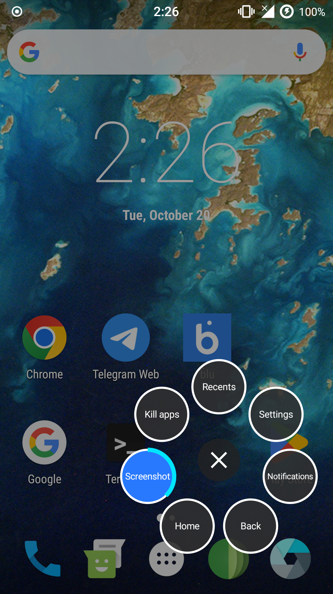

Hey everyone i've built a hover gesture for Galaxy s4 GT-I9500!

If nothing appears after boot, run in a root shell:
    cat /data/local/tmp/hoverdwell-boot.log
    cat /data/local/tmp/hoverdwell.log
and include both in your bug report.
Licensed under the MIT License (see LICENSE).